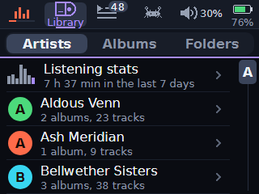
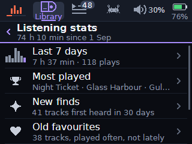
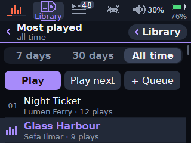
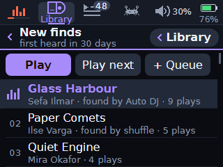
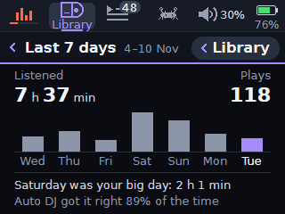
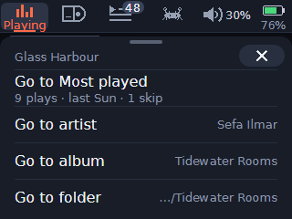
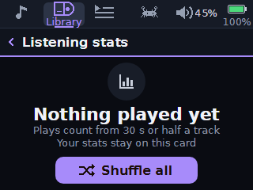
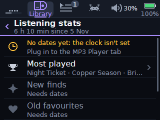
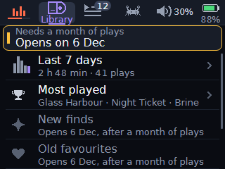

# Listening stats: the design frames

The nine final frames of the design, for [docs/LISTENING-STATS.md](../../LISTENING-STATS.md). Each file is named as the plan names its frame ("frame Entry" is `Entry.png`). The owner picked this direction, C ("Woven"), on 2026-11-10. AlbumPlays was dropped by the owner (decision O3), and the A- (Glance), B- (Recap) and C- frames are the directions not taken (the plan's section 14), so none of them is here.

Each frame is 320 x 240, the Core2's screen at its real size. They are **browser-font renders**: the design canvas's static HTML frames (`.dc.html`), captured in headless Chrome 157 on a PC. The text is the browser's DejaVu Sans, rasterised and hinted by the browser, not the firmware's VLW glyphs (`src/ui/VlwFonts.cpp`, made from the same font), and the icons are the canvas's drawings. So widths and edges can differ from the device by a pixel or two: they are checked for layout and colour, not pixel for pixel (3.2, "Frames"). Names, artists and numbers are made up.

The canvas: https://claude.ai/artifact/MhGiBt7yLecJZEErFQgSTq.

## Where the plan and the firmware depart from the frames

The plan follows the code, its own defaults and the owner's calls (3.2, "Frames"; 3.1, O1; section 1), and the firmware (S3b, section 7) follows the plan:

- **NoPlays** draws "Nothing played yet"; the plan uses the phone app's "No plays yet" (`stats.empty_title`).
- **Entry** draws "7 h 37 min in the last 7 days" and the week's bars; the firmware draws the lifetime line, "74 h 10 min since 1 Sep" (Small, room 204; the time alone where that is wider, or before counting has a first day; no plays: the owner's call "Time alone", 2026-11-22), and the bars as a fixed icon at the frame's own heights (7.3).
- **Week** draws "Listened"; the plan uses "Listening time" (`stats.listened`). Its sub reads "4–10 Nov (UTC)" until the time zone arrives (S6), under the title, not beside it as in the frame (beside it only in Chinese, on 28 of 366 weeks), and only while the week's figures show (7.7).
- **MostPlayed** draws its All time sub as "all time"; the plan says "since 1 Sep" (every lifetime figure says its window). The frame has no line under its tray; the firmware draws the list's 1 px row divider there (y 113), as under every list's lead item, for the owner to look at in run 3b-1 (7.6).
- **NoClock** draws the Not played yet row (below the frame's fold) open; the firmware does so only when the card's dated plays span 30 days or more (DAYS' first to newest dated day, as the visit's snapshot gives it; open until it lands), else draws it disabled with `stats.needs_dates` (4.4; 3.1's O5, the owner's call "30 days, kept without clock", 2026-11-20).
- **Not played yet's icon** (the hub's row 5, below every frame's fold), a ring with a play mark, is the firmware's own design; the other five icons are the frames' pixels (7.4).
- **The Try again row** (on the hub and the shelves when an ask came to nothing, or "The card is back" once the card is in again: the owner's call "The card is back", 2026-11-22) is in no frame; the firmware draws it with no icon and no chevron, as it opens no page (7.4).

**EarlyDays** is not a departure: the firmware splits a toast at its ": " when it is too wide for one Body line, and "Needs a month of plays: Opens on 6 Dec" is too wide (326 px against 284), so the frame's two lines are what the firmware draws.

## The frames

|  |  |  |
|---|---|---|
| `Entry` (7.3): the way in, Library > Artists' first row: the bars and, as built, the lifetime line (above) | `Main` (7.4): the hub, Listening stats, its lifetime total and six rows | `MostPlayed` (7.6): Most played, opened on All time, with its tray for 7 and 30 days |
|  |  |  |
| `NewFinds` (7.6): tracks first heard in 30 days, and who found them | `Week` (7.7): Last 7 days, a page of its own: time, plays, seven bars, the big day, Auto DJ's rate | `NowPlayingSheet` (7.8): Now Playing's navigation sheet with its first row, Go to Most played |
|  |  |  |
| `NoPlays` (7.5): the hub with nothing played, the empty state with Shuffle all | `NoClock` (4.4, 7.4): the clock never set, the status row and the rows that need dates disabled (Not played yet, below the fold, open on a card with 30 days of dates) | `EarlyDays` (4.4, 7.6): day 5 of counting, a tap on a row that opens after a month, and its toast |
