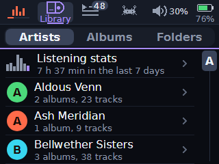
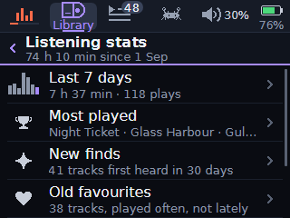
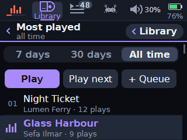
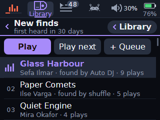
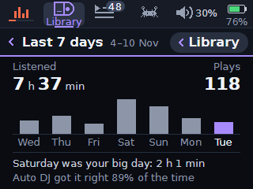
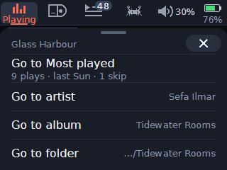
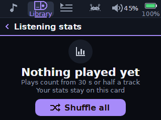
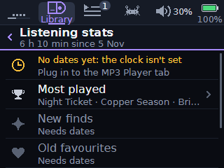
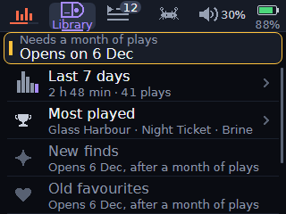

# Listening stats: the design frames

The nine final frames of the design, for [docs/LISTENING-STATS.md](../../LISTENING-STATS.md). Each file is named as the plan names its frame ("frame Entry" is `Entry.png`). The owner picked this direction, C ("Woven"), on 2026-11-10. AlbumPlays was dropped by the owner (decision O3), and the A- (Glance), B- (Recap) and C- frames are the directions not taken (the plan's section 14), so none of them is here.

Each frame is 320 x 240, the Core2's screen at its real size. They are **browser-font renders**: the design canvas's static HTML frames (`.dc.html`), captured in headless Chrome 157 on a PC. The text is the browser's DejaVu Sans, rasterised and hinted by the browser, not the firmware's VLW glyphs (`src/ui/VlwFonts.cpp`, made from the same font), and the icons are the canvas's drawings. So widths and edges can differ from the device by a pixel or two: they are checked for layout and colour, not pixel for pixel (3.2, "Frames"). Names, artists and numbers are made up.

The canvas: https://claude.ai/artifact/MhGiBt7yLecJZEErFQgSTq.

## Where the plan departs from the frames

The plan follows the code and its own defaults (3.2, "Frames"; 3.1, O1):

- **NoPlays** draws "Nothing played yet"; the plan uses the phone app's "No plays yet" (`stats.empty_title`).
- **Week** draws "Listened"; the plan uses "Listening time" (`stats.listened`). Its sub reads "4–10 Nov (UTC)" until the time zone arrives (S6), and drops under the title then (7.7).
- **MostPlayed** draws its All time sub as "all time"; the plan says "since 1 Sep" (every lifetime figure says its window).
- **NoClock** draws the Not played yet row (below the frame's fold) open; the plan draws it disabled, with `stats.needs_dates` (4.4, O5's no-clock case).
- **EarlyDays** draws its toast on two lines; the firmware splits a toast only when it is too wide for one Body line, so in English "Needs a month of plays: Opens on 6 Dec" is one line.

## The frames

|  |  |  |
|---|---|---|
| `Entry` (7.3): the way in, Library > Artists' first row, the last 7 days' bars and time | `Main` (7.4): the hub, Listening stats, its lifetime total and six rows | `MostPlayed` (7.6): Most played, opened on All time, with its tray for 7 and 30 days |
|  |  |  |
| `NewFinds` (7.6): tracks first heard in 30 days, and who found them | `Week` (7.7): Last 7 days, a page of its own: time, plays, seven bars, the big day, Auto DJ's rate | `NowPlayingSheet` (7.8): Now Playing's navigation sheet with its first row, Go to Most played |
|  |  |  |
| `NoPlays` (7.5): the hub with nothing played, the empty state with Shuffle all | `NoClock` (4.4, 7.4): the clock never set, the status row and the rows that need dates disabled | `EarlyDays` (4.4, 7.6): day 5 of counting, a tap on a row that opens after a month, and its toast |
