# Mood filters: the design frames

The frames the design was picked from, for [docs/MOOD-FILTERS.md](../../MOOD-FILTERS.md). The owner picked editor 1, the one-screen grid, and way in A, the quiet first row with a dot when scrolled. The other directions are kept for the record.

Each frame is 320 x 240, the Core2's screen at its real size. They were drawn on a PC with the firmware's own fonts (`src/ui/VlwFonts.cpp`), CJK glyph store (`lib/core/CjkGlyphs16.cpp`), icons (`src/ui/IconData.cpp`) and 565 colours (`src/ui/Theme.h`). The tab bars and the Now Playing frame under the toasts are real device captures. Album names, artists and covers are made up. They are mockups, not screenshots: the Albums list in particular has no real capture yet.

Two differences from the plan:

- The three toasts in "What Auto DJ says elsewhere" are drawn on two lines. The firmware splits a toast only when it is too wide, so in English each stays on one line, and the plan follows the code (section 3.2).
- The crosses are drawn 10 x 10; the plan uses the firmware's `kCross`, 12 x 12.

## Today and the three editors

The Albums list today, then one frame of each editor.

|  | 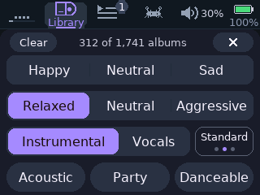 |
|---|---|
| `today-albums`: Albums today, drawn from the code | `grid-two`: 1: one-screen grid, every choice one tap away (picked) |
| 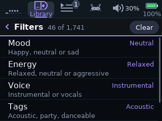 | 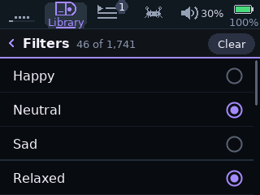 |
| `rows-set`: 2: overview rows, as the Auto DJ page is built | `list-top`: 3: flat checklist, every word its own row |

## Editor 1: the one-screen grid (picked)

A joined tray is pick one; a round chip is pick any; the dots are how sure.

|  |  |
|---|---|
| `grid-empty`: Nothing set: Clear is dim, the count is the whole list | `grid-two`: Two choices: the count follows each tap |
| 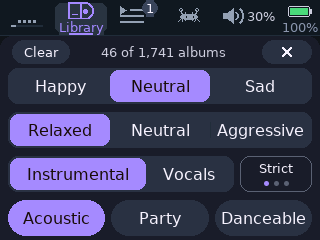 | 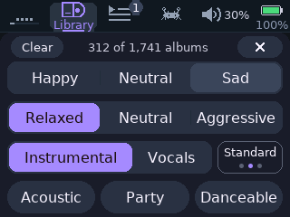 |
| `grid-set`: Tray: pick one. Round chip: pick any. Dots: how sure | `grid-press`: A finger on Sad: only that tray redraws |
| 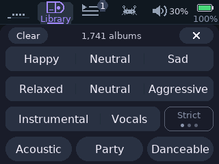 | 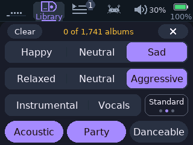 |
| `grid-level`: Strict with nothing set: kept, but it filters nothing | `grid-zero`: Nothing fits: the count turns amber |
| 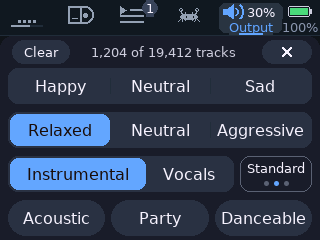 | 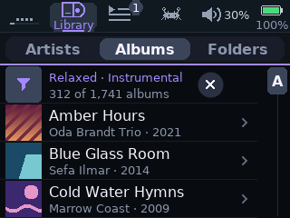 |
| `grid-dj`: From Auto DJ: blue, and it counts tracks | `inA-on`: Closed with the cross: the list, filtered |

## Editor 2: overview rows (not picked)

| 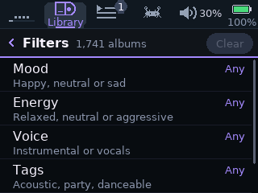 |  |
|---|---|
| `rows-empty`: Nothing set: a tap cycles a row's value | `rows-set`: Set: state reads at a glance, options don't |
| 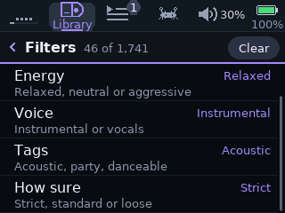 | 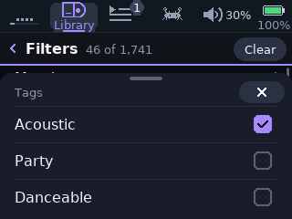 |
| `rows-end`: Scrolled: the fifth row, How sure | `rows-tags`: Tags: a sheet of checks that stays up |
| 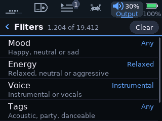 | 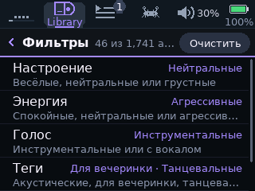 |
| `rows-dj`: From Auto DJ: blue | `lang-rows-ru`: Russian: four new group names, draft words, unreviewed |

## Editor 3: flat checklist (not picked)

|  | 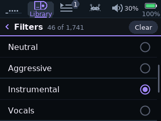 |
|---|---|
| `list-top`: First screen: a thicker line between groups | `list-mid`: Second screen: the two Neutrals are a scroll apart |
| 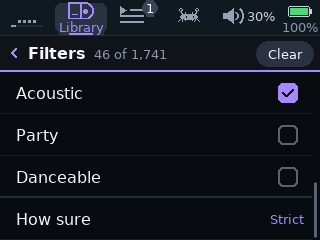 | 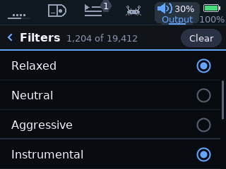 |
| `list-end`: Third screen: square checks for tags, then how sure | `list-dj`: From Auto DJ: blue |
| 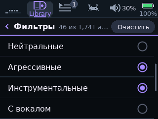 | 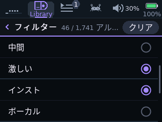 |
| `lang-list-ru`: Russian: every word fits on its own row | `lang-list-ja`: Japanese |

## The way in on Albums

A (picked): the first row, and a dot when scrolled. B and C were not picked.

| 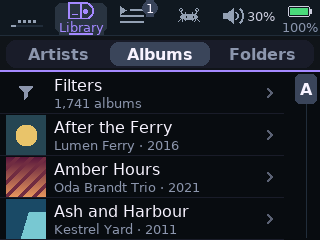 |  |
|---|---|
| `in-rest`: Nothing set, all three: a quiet first row | `inA-on`: A, filter on: the first row says what and how many |
| 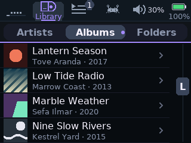 | 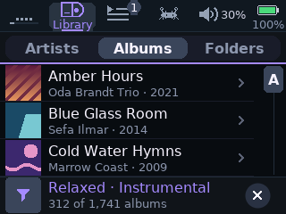 |
| `inA-scrolled`: A, scrolled: a dot on Albums; a tap on it goes back up | `inB-on`: B, filter on: a fixed bar replaces the first row |
| 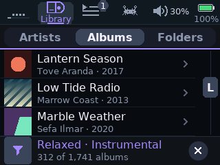 | 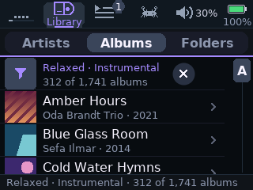 |
| `inB-scrolled`: B, scrolled: the bar and its way out stay, one row less | `inC-on`: C, filter on: the first row, and the status band |
| 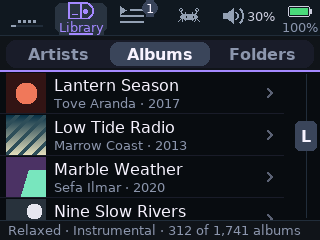 | |
| `inC-scrolled`: C, scrolled: the band still says so, with no way out | |

## Albums: every other state

The plan assumes the line form when nothing fits, and no row on a card with no mood data (section 3).

| 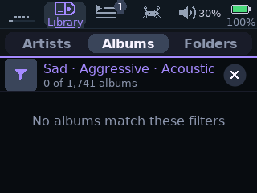 | 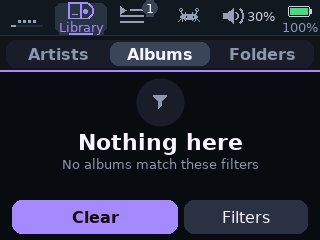 |
|---|---|
| `A-empty-line`: Nothing fits, line form: the first row stays | `A-empty-full`: Nothing fits, full form: with Clear and Filters |
| 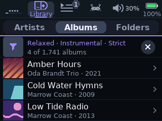 | 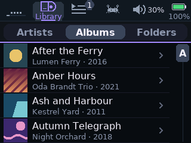 |
| `A-few`: A short list: no rail, so the row is full width | `A-nodata-hidden`: No mood data on this card: no row at all |
| 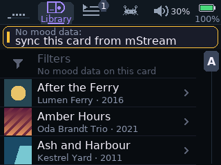 | 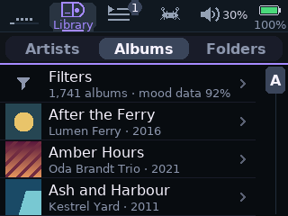 |
| `A-nodata-dim`: No mood data, the other way: dim, a tap explains | `A-partial`: Part of the card analysed: said once, at rest (left out of v1) |
| 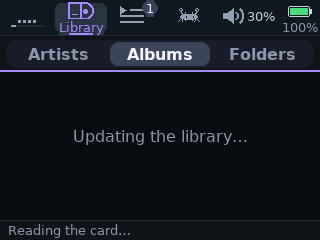 | 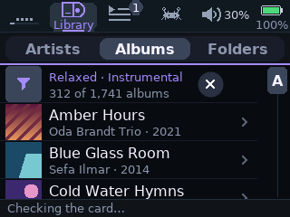 |
| `A-updating`: A library update: the filter waits behind it | `A-band`: The card's status band over a filtered list |
| 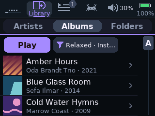 | |
| `A-playall`: Only if Play all is wanted: a bar with Play first (not in v1) | |

## Output > Auto DJ

| 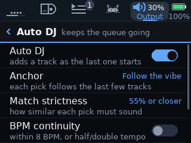 | 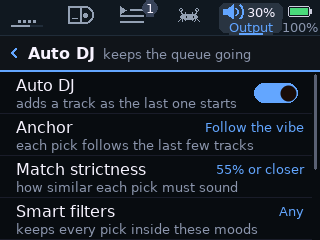 |
|---|---|
| `today-autodj`: Today | `dj-any`: The new row, fourth on the first screen: Any |
| 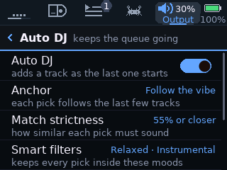 | 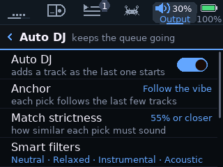 |
| `dj-two`: Two choices fit beside the title | `dj-many`: More: the value takes the second line, and cuts |
| 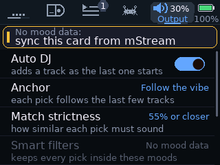 | 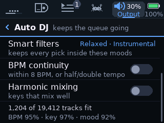 |
| `dj-nodata`: No mood data: dim, a tap explains, picks unfiltered | `dj-status`: The last row counts what fits, and mood coverage |
| 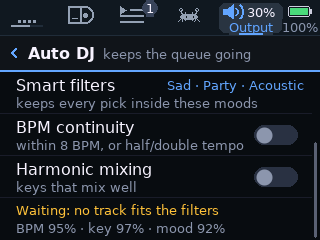 | 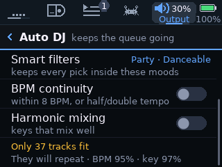 |
| `dj-waiting`: Nothing fits: Auto DJ waits and says why | `dj-few`: Few fit: 50 or under can't hold the cooldown |

## What Auto DJ says elsewhere

These three toasts are drawn on two lines; the firmware keeps each on one line in English, and the plan follows the code (section 3.2).

| 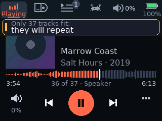 | 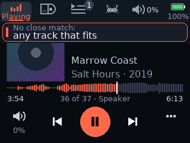 |
|---|---|
| `dj-toast-few`: Toast: few fit, once at the start or a change | `dj-toast-jump`: Toast: a pick leaves the neighbours |
| 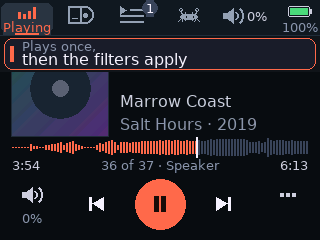 | 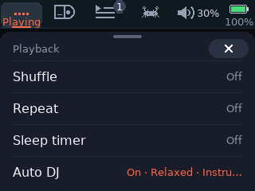 |
| `dj-toast-once`: Toast: a queued pick outside a new filter | `dj-menu`: Now Playing's ... sheet: on, and with what |
| 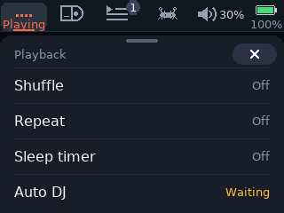 | 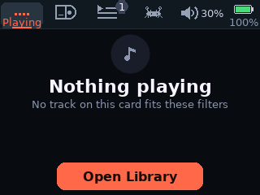 |
| `dj-menu-wait`: The same row when nothing fits | `dj-empty`: Empty queue, nothing fits: the Auto DJ button goes |

## Ten languages

The grid with the widest choices set, then the first row and the other editors in the widest languages.

|  | 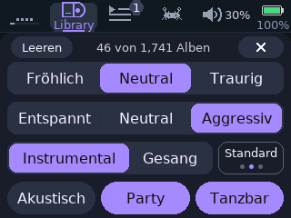 |
|---|---|
| `lang-grid-en`: English | `lang-grid-de`: German |
| 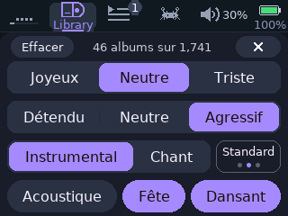 |  |
| `lang-grid-fr`: French | `lang-grid-it`: Italian |
|  |  |
| `lang-grid-es`: Spanish | `lang-grid-pt`: Portuguese |
|  |  |
| `lang-grid-pl`: Polish: all in the small font | `lang-grid-ru`: Russian: small font, one tag on two lines |
|  |  |
| `lang-grid-ja`: Japanese: widths follow the words | `lang-grid-zh`: Chinese |
|  |  |
| `lang-row-ru`: First row, Russian: the summary cuts with an ellipsis | `lang-row-ja`: First row, Japanese: Artists fills its segment |
|  |  |
| `lang-row-pl`: First row, Polish | `lang-rows-ja`: Overview rows, Japanese: group names are draft words |
